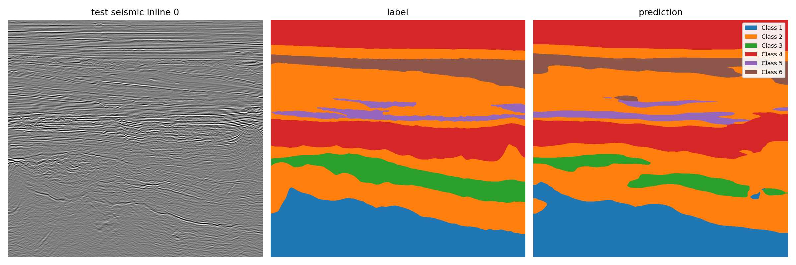
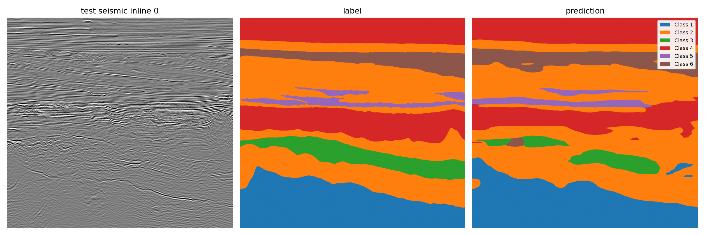
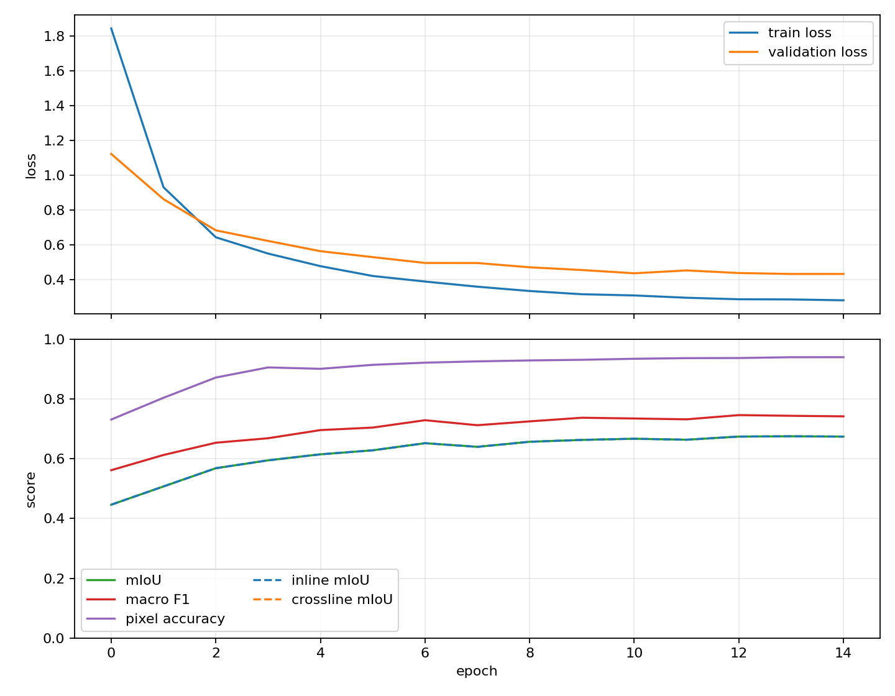
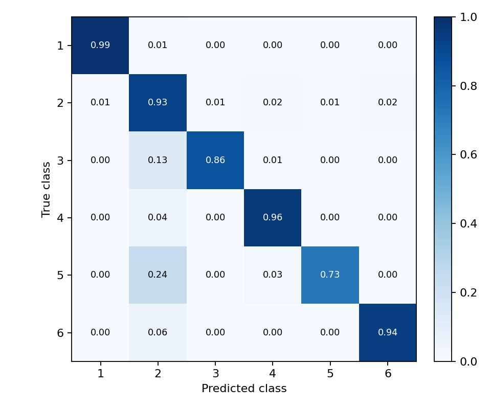
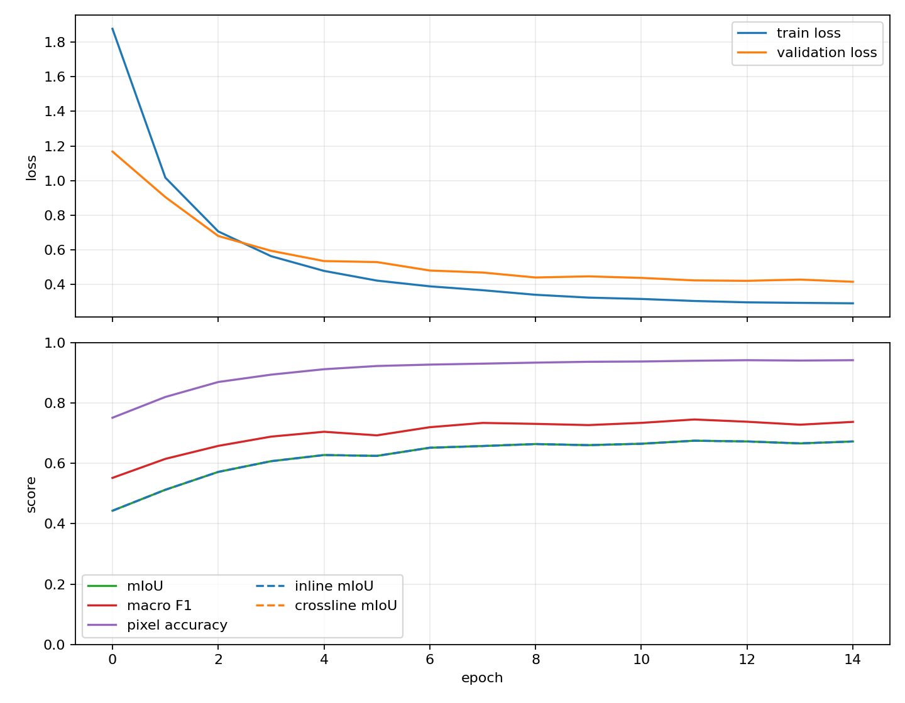
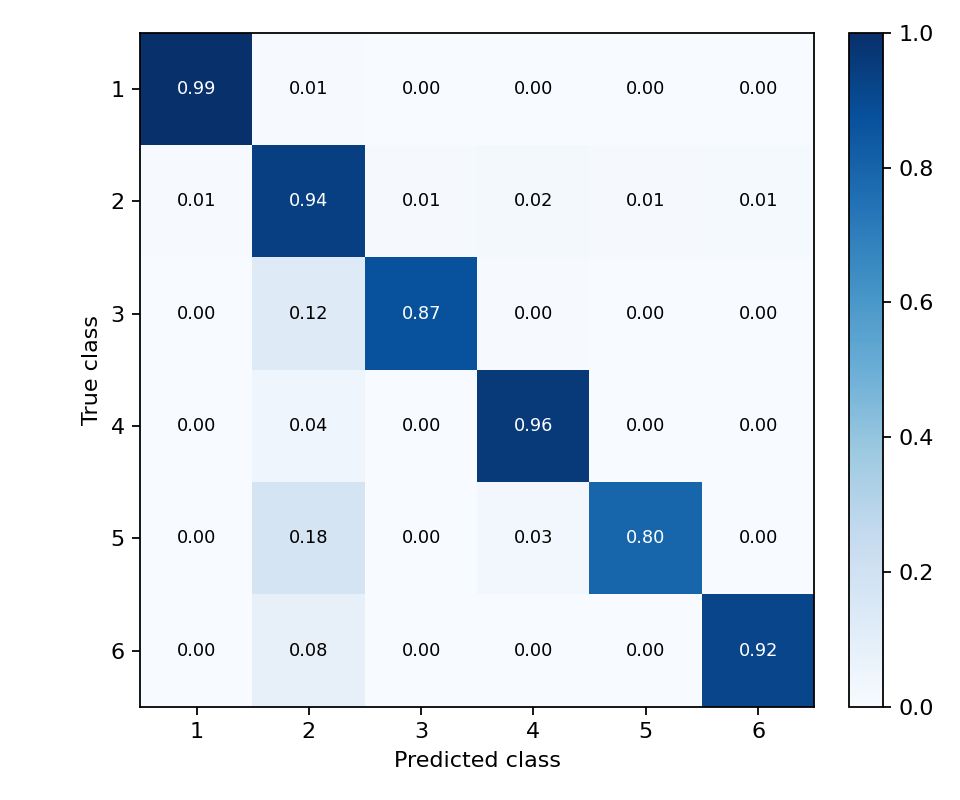
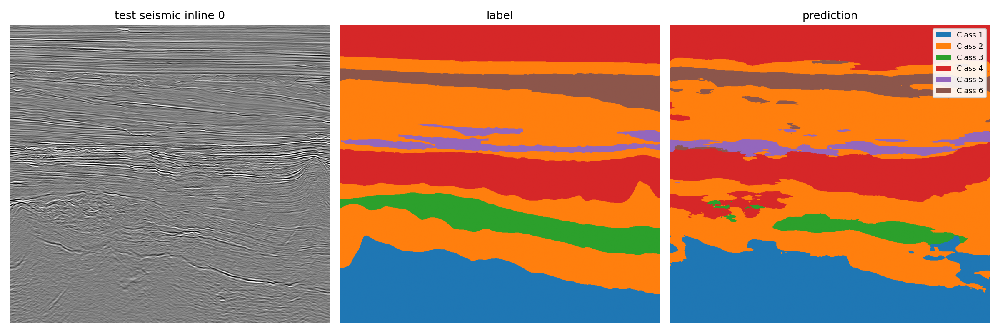
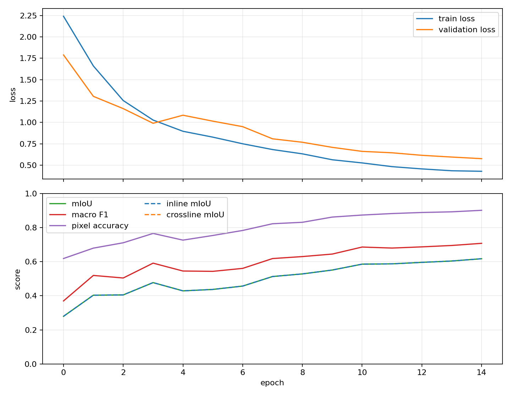

# Parihaka Facies Segmentation

A Google Colab project for 3D seismic facies segmentation. This README includes the completed comparison of DINOv2 small + FAPM, DINOv3 small + FAPM, and a seismic U-Net.

| Model | Labeled test mIoU | Notebook |
|:---|---:|:---|
| DINOv3 small + FAPM | **0.8447** | [Open notebook](Parihaka_DINOv3_FAPM_Colab.ipynb) |
| DINOv2 small + FAPM | 0.8325 | [Open notebook](Parihaka_DINO_UNet_Colab.ipynb) |
| Seismic U-Net | 0.7635 | [Open notebook](Parihaka_Seismic_UNet_Colab.ipynb) |



[Standalone report](reports/comparison.html) · [A4 PDF](output/pdf/comparison.pdf) · [Report Markdown](reports/comparison.md)

## Model comparison

**Models:** DINOv2 small with FAPM, DINOv3 small with FAPM, and a seismic U-Net

**Evaluation:** shared spatial split of the labeled Parihaka volume

### Executive summary

DINOv3 achieved the highest labeled test mIoU at **0.8447**, followed by DINOv2 at **0.8325** and U-Net at **0.7635**. DINOv3's advantage over DINOv2 is 0.0122 mIoU, while their best validation scores are nearly identical. DINOv3 also has the best test macro F1 and negative log likelihood (NLL).

The difference between validation and test scores needs careful interpretation. Validation uses eight selected inlines, while test covers 94 complete inlines. Class 5 accounts for 0.042% of validation pixels and 1.733% of test pixels. All three models score higher on test than on validation, but that increase cannot be attributed to better generalization. This report describes one run per model and does not claim statistical significance.

### 1. Data and evaluation protocol

The labeled volume has shape **590 × 782 × 1006**, ordered as inline, crossline, and depth. The comparison uses a fixed spatial partition. Training contains 354 inlines in three blocks. Validation occupies `[378, 472)`, with eight full inlines selected for scoring. The labeled test set contains 94 full inlines in `[0, 31)`, `[107, 138)`, and `[558, 590)`. Six eight-inline buffer blocks separate the regions.

The models receive 224 × 224 patches with amplitude, vertical gradient, and depth channels. Each run uses 15 epochs, 4,096 sampled training examples per epoch, and cross entropy with Lovasz loss. Validation and test predictions use overlapping tiles to cover complete inlines. Metrics are computed from an aggregate confusion matrix, so each evaluated pixel contributes once. The best checkpoint is selected by validation mIoU; test metrics are calculated after that selection.

The downloaded artifacts passed `python scripts/audit_comparison_outputs.py outputs`. All three runs are marked complete. Each manifest lists the expected 16 files, their recorded sizes match the downloaded files, and the split and test inline lists agree across models.

### 2. Overall results

| Model | Best validation mIoU | Test mIoU | Test macro F1 | Test pixel accuracy | Test NLL | Selected epoch |
|:---|---:|---:|---:|---:|---:|---:|
| DINOv2 small with FAPM | **0.6749** | 0.8325 | 0.9030 | 0.9416 | 0.1498 | 14 |
| DINOv3 small with FAPM | 0.6748 | **0.8447** | **0.9118** | **0.9447** | **0.1436** | 12 |
| Seismic U-Net | 0.6170 | 0.7635 | 0.8571 | 0.9089 | 0.2244 | 15 |

The two DINO models have essentially equal best validation mIoU. DINOv3 leads on the held-out test set by **1.22 percentage points** of mIoU. U-Net trails DINOv3 by **8.13 percentage points** on test mIoU. The ranking is consistent across test mIoU, macro F1, pixel accuracy, and NLL, but these are single-run comparisons.

### 3. Results by class

The values below are test IoU for the dataset's numeric class labels. They should not be read as geological facies names.

| Model | Class 1 | Class 2 | Class 3 | Class 4 | Class 5 | Class 6 |
|:---|---:|---:|---:|---:|---:|---:|
| DINOv2 small with FAPM | 0.9736 | 0.8742 | 0.8025 | 0.9247 | 0.5780 | 0.8423 |
| DINOv3 small with FAPM | **0.9745** | **0.8799** | **0.8100** | **0.9301** | **0.6315** | **0.8424** |
| Seismic U-Net | 0.9593 | 0.8193 | 0.7385 | 0.8740 | 0.4872 | 0.7023 |

Class 5 has the lowest test IoU for every model. DINOv3 improves its class 5 IoU by **0.0535** over DINOv2. The most frequent class 5 error is prediction as class 2: **309,915** pixels for DINOv2, **227,436** for DINOv3, and **313,840** for U-Net. The full confusion matrices are available in the linked figures below.

### 4. Class distribution across evaluation sets

The table gives each class's share of evaluated pixels. Class 3 and class 5 are substantially more common in test than in the selected validation inlines.

| Set | Class 1 | Class 2 | Class 3 | Class 4 | Class 5 | Class 6 |
|:---|---:|---:|---:|---:|---:|---:|
| Validation | 19.291% | 40.728% | 1.547% | 29.164% | 0.042% | 9.228% |
| Test | 16.003% | 42.344% | 6.122% | 26.599% | 1.733% | 7.198% |

Class 5 validation IoU is **0.0417** for DINOv2, **0.0599** for DINOv3, and **0.0730** for U-Net. The order reverses on test, where DINOv3 leads at 0.6315. The very small validation support for this class is a reason to avoid model selection or broad conclusions based on its validation IoU alone.

### 5. Training behavior and compute

The training curves show falling loss and rising validation mIoU for all three models. Validation improvement becomes modest in the later DINO epochs. U-Net continues to improve through its final epoch, which is also its selected checkpoint. DINOv2 selects epoch 14 and DINOv3 selects epoch 12. Epoch numbers in this report are one based.

| Model | Training batch | Total parameters | Recorded epoch time | Peak GPU memory |
|:---|---:|---:|---:|---:|
| DINOv2 small with FAPM | 128 | 30.24 million | 8.24 minutes | 46.75 GB |
| DINOv3 small with FAPM | 128 | 29.78 million | 22.46 minutes | 47.18 GB |
| Seismic U-Net | 256 | 8.29 million | 9.90 minutes | 50.51 GB |

The times sum `epoch_time_sec` over 15 epochs. They exclude data preparation, final test evaluation, and Colab setup. Hardware identity and competing workload are not established by these artifacts, so the table is descriptive rather than a controlled speed benchmark. U-Net's training batch differs from the two DINO runs, which also affects optimization step count and limits a strict compute comparison.

### 6. Visual inspection

The three prediction previews use the same test inline, **inline 0**. In this example, the DINO predictions follow the main layered structures more continuously. The U-Net prediction contains more fragmented patches. This is a qualitative observation from one inline; the reported test metrics cover all 94.

#### DINOv2 small with FAPM



**Training curves**



**Test confusion matrix**



#### DINOv3 small with FAPM


**Training curves**



**Test confusion matrix**



#### Seismic U-Net



**Training curves**



**Test confusion matrix**


### 7. Interpretation and limitations

**Class composition differs sharply.** Validation has **2,616 class 5 pixels among 6,293,536**, while test has **1,281,905 among 73,949,048**. Their respective shares are **0.042%** and **1.733%**. The limited class 5 support in validation makes its class 5 IoU especially sensitive to which eight inlines were selected. The test set is larger and has a different class balance.

**The spatial buffer is narrower than in the earlier protocol.** The distributed test design uses eight-inline buffers. This keeps training, validation, and test in distinct physical regions, but nearby geological structures may still be correlated. The result should be interpreted as performance on this fixed spatial holdout, not as evidence of independence across all possible surveys.

**The runs are not identical in every training setting.** The U-Net batch size is 256, compared with 128 for the two DINO models. The models also differ in architecture and parameter count by design. All three share the data split and evaluation method, which supports a direct comparison of their recorded predictions, but a controlled architecture ablation would require additional matched runs.

**Uncertainty is not measured.** There is one completed run per model and one fixed split. No confidence interval, seed variance, or statistical test is available. The 0.0122 mIoU difference between DINOv3 and DINOv2 should therefore be treated as an observed result, not a guaranteed performance advantage.

### Conclusion

DINOv3 has the strongest recorded test performance in this comparison, including the best result on the difficult class 5. DINOv2 is close on validation and test mIoU. U-Net is smaller and remains a useful baseline, but its test score is lower. The next experiment that would most improve confidence is a repeated comparison with matched batch settings and additional spatial splits or seeds.

## Run in Colab

1. Put this folder in Google Drive at `/content/drive/MyDrive/parihaka_dino_unet`.
2. Open the appropriate `Parihaka_*_Colab.ipynb` notebook in Colab and select a GPU runtime.
3. Set the seismic and label SEG-Y paths in the notebook's `USER_CONFIG` if they differ from the defaults.
4. Run the cells in order.

The existing comparison used GPUs with recorded peak memory around 47–51 GB. Choose a GPU and batch setting that fit available memory; reducing the batch size and increasing gradient accumulation changes the run configuration, so report the settings with any new results.

### Publish notebooks with real outputs

The notebooks currently in this repository are unexecuted templates. After each Colab run finishes through the final artifact manifest cell, ensure **Omit code cell output when saving this notebook** is off in Colab's notebook settings. Download the executed `.ipynb` from Colab's File menu and replace the matching file here. GitHub renders saved outputs as static content, including the training curve, validation plots, test confusion matrix, test prediction, and printed metrics.

Before uploading the executed notebooks, review their printed outputs for private account names or paths and update the tables in this README if the new runs produce different scores. If you also download the complete model output folders, run `python scripts/audit_comparison_outputs.py <downloaded-output-folder>` to check them. The large checkpoints and raw data remain outside Git; the notebook outputs and the report images are the public visual record.

Expected data paths (the first two are required for training):

```text
data/TrainingData_Image.segy
data/TrainingData_Labels.segy
data/TestData_Image1.segy
data/TestData_Image2.segy
```

Absolute Drive paths may also be used in `USER_CONFIG`. If `DAGSHUB_TOKEN` is available in Colab Secrets, MLflow tracking is enabled; otherwise results are still saved locally. DINOv3 requires access to its gated Hugging Face model and an `HF_TOKEN`.

The active configurations are `configs/comparison_dinov2_small.yaml`, `configs/comparison_dinov3_small.yaml`, and `configs/comparison_seismic_unet.yaml`. They use a common spatial split, amplitude/vertical-gradient/depth inputs, sampling, augmentation, loss, and full-inline evaluation. The DINO runs use batch size 128; U-Net uses 256, as recorded in the completed run configurations. Each uses 15 epochs and 4,096 sampled training examples per epoch.

## Features and sampling

The comparison's three input channels are normalized center seismic amplitude, clipped vertical depth gradient, and normalized depth coordinate in `[-1, 1]`. Legacy `neighbor_triplet` features instead use the previous, center, and next section.

Class-aware sampling selects half of training patches by first choosing one of the six classes and then a training section and pixel that contain it. Other patches use ordinary random sampling. The notebooks show diagnostic patches for each class; these examples do not contribute to validation metrics.

At split boundaries, missing neighbor channels are filled with an edge section from the same region. Training examples do not read from buffer, validation, or test regions. Validation uses eight complete inlines chosen to cover all six classes and different locations. Overlapping 224-pixel tiles cover each inline, and blended probabilities contribute each pixel once to the global confusion matrix.

## Outputs

The notebooks save checkpoints, run logs, metrics, confusion matrices, training curves, and fixed-section predictions. They do not generate a full-volume NPY or SEG-Y submission file. Configuration output paths are under `outputs/comparison_v2/<model>/`; the downloaded model folders analyzed here are placed directly under `outputs/<model>/`.

`logs/run_status.json` records the training stage or error type. `logs/artifact_manifest.json` lists required files and sizes. The audit command above checks missing files, incomplete training, mismatched splits, and test coverage. Raw outputs and checkpoints are ignored by version control; the nine figures displayed here are stored in `reports/assets/`.

## Dataset context

This project uses the Parihaka challenge volume. The referenced paper *A Machine Learning Benchmark for Facies Classification* studies the Netherlands F3 dataset. Their datasets and facies labels differ. Only general methods, such as spatial holdouts and representation of small classes in validation, carry over; F3 class names and test regions are not applied to these Parihaka results.
